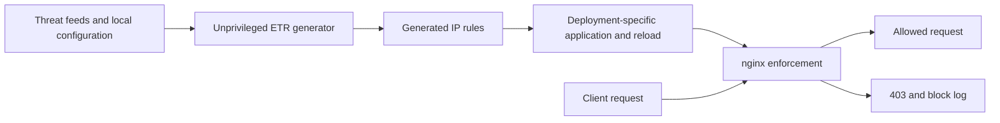

# Emerging Threats Rule Generator (ETR)

ETR downloads IP threat feeds, applies whitelist exclusions, and generates an
nginx `geo` blocklist. Run it natively on a Linux host or alongside nginx in
Docker. The nginx configuration decides which requests to reject.

Threat feeds refresh automatically. Native software updates are opt-in;
the default release checker logs available signed versions without installing
them. Docker software updates are managed by replacing the image.

## Start here

| I want to… | Read |
| --- | --- |
| Install on Ubuntu, ServerPilot, or RHEL | [Native installation](native-install.md) |
| Run nginx and ETR in Docker | [Docker setup](docs/docker.md) |
| Choose feeds, exemptions, scheduling, or notifications | [Configuration reference](docs/configuration.md) |
| Understand enforcement and forwarded client IPs | [nginx integration](docs/nginx.md) |
| Verify blocking on a test deployment | [Manual testing](testing.md) |
| Query blocked-request logs | [Log reporting](reporting.md) |
| Upgrade from v2 | [Migration guide](MIGRATING-v3.md) |
| Change code or run checks | [Contributing](CONTRIBUTING.md) |
| Find the implementation of a feature | [Architecture and source map](docs/architecture.md) |
| Publish a release | [Release procedure](releasing.md) |
| Review known security boundaries | [Security review](security-review.md) |

## How it works

The native root helper accepts a restricted rule grammar before installing an
nginx include. Docker examples share a rules volume and restart the configured
nginx containers. A generated file alone does not enforce blocking: nginx must
include it and use `$blocked_source` in a request-handling rule.

The checker examples expose `/check_ip` for a proxy's forward-auth request.
The reverse-proxy examples enforce the rules directly before proxying to an app.
An empty User-Agent is a separate blocking rule in the examples; remove it if
that policy does not suit your traffic.

## Deployment boundaries

- The native downloader and software updater run as `etr`. The separately
  installed root helper is not self-updated. Choose automatic application,
  an operator-owned root cron schedule, or generation without a helper.
- Docker socket access gives the generator authority over a rootful Docker
  host even though its container runs as nonroot. To avoid that authority,
  remove the socket mount and group grant, set `RESTART_CONTAINERS=false`, and
  provide a separately controlled apply/reload workflow.
- Trust only your actual proxies when accepting forwarded client IPs.
- Release signatures authenticate the publisher; they do not prove that code
  or blocking decisions are safe. See the [security review](security-review.md)
  for open findings and validation limits.

## Examples

| Proxy or deployment | Example |
| --- | --- |
| Basic generator and nginx | [docker-compose.example.yml](docker-compose.example.yml) |
| Traefik v2 | [examples/traefik-v2](examples/traefik-v2/) |
| Traefik v3 | [examples/traefik-v3](examples/traefik-v3/) |
| Caddy | [examples/caddy](examples/caddy/) |
| nginx reverse proxy | [examples/nginx-reverse-proxy](examples/nginx-reverse-proxy/) |
| pfSense HAProxy | [examples/pfsense](examples/pfsense/README.md) |

Read the [example setup notes](examples/README.md) before copying a deployment.
Images are published at [Docker Hub](https://hub.docker.com/r/mxmd/etr).
The `v3` tag can move on development builds; use a reviewed version or digest
for a controlled rollout.

<!-- Keep these headings as destinations for existing documentation links. -->
## Quick Start

Use the [Docker quick start](docs/docker.md#quick-start) or
[native installer](native-install.md#1-install-or-upgrade).

## Configuration (`config.json`)

See the [JSON field reference](docs/configuration.md#json-fields).

## Whitelisting

See [feed parsing and whitelists](docs/configuration.md#feed-parsing-and-whitelists).

## Notifications

See [notification channels](docs/configuration.md#notification-channels).

## Environment Variables

See [scheduling and application](docs/configuration.md#scheduling-and-application)
and [native software checks](native-install.md#6-software-release-checks-and-opt-in-updates).

## Docker Compose

See [Docker setup](docs/docker.md) and the [example index](examples/README.md).

## Nginx Configuration (`nginx/default.conf`)

See [nginx integration](docs/nginx.md).

### Real IP trust

See [trusted proxies and client addresses](docs/nginx.md#real-ip-trust).

## License

[MIT](LICENSE).
